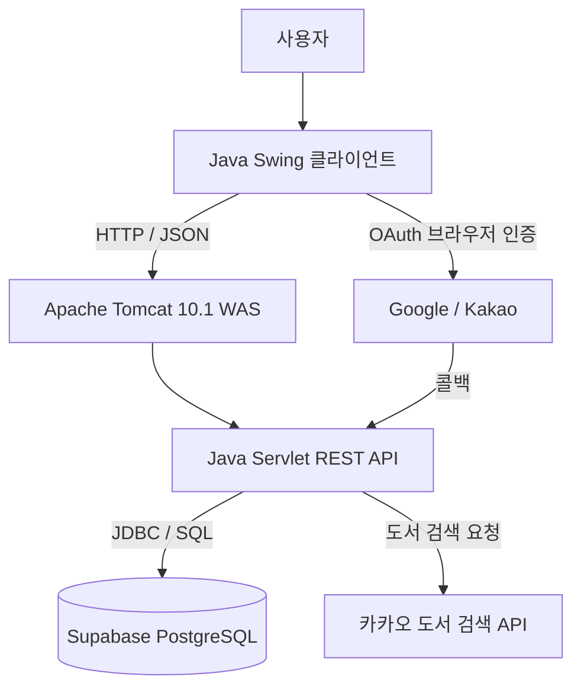

<div align="center">

# 📚 BookMarket v2

### Java Swing와 Apache Tomcat 기반 온라인 서점 시스템

**상품 탐색부터 주문·취소, 재고 관리까지 — 클라이언트와 서버를 분리한 데스크톱 서점 프로젝트**


**[주요 기능](#-주요-기능) · [시스템 구조](#-시스템-아키텍처) · [실행 방법](#-로컬-실행-방법) · [검증 결과](#-검증-결과)**

</div>

---

## 🎯 프로젝트 소개

BookMarket v2는 Java Swing으로 제작한 기존 서점 프로그램을 **3계층 구조**로 확장한 프로젝트입니다. 클라이언트는 화면과 사용자 입력을 담당하고, **Apache Tomcat WAS**에서 실행되는 Java Servlet REST API가 인증·도서 조회·주문·재고 로직을 처리하며, **Supabase PostgreSQL**에 데이터를 저장합니다.

> **프로젝트 목표:** Java Swing 데스크톱 UI와 Tomcat WAS를 연동해 실제 데이터베이스 기반의 온라인 서점 기능을 구현합니다.

### 프로젝트 특징

- 도서 약 **27,000권**의 서버 기반 검색·페이지네이션
- 도서 상세 보기, 장바구니, 배송지 입력, 주문 내역 및 주문 취소
- 일반 로그인 및 Google·Kakao OAuth 연동
- 관리자 권한 기반 재고 수정, 품절·재고 부족 필터 및 재고 통계
- 주문 처리 시 트랜잭션·행 잠금·재고 부족 방어 로직 적용

> 도서 수는 개발 당시의 테스트 DB 기준 **27,047권**으로, 운영 환경에 따라 달라질 수 있습니다. 재고는 시연용 값이 포함되어 있으며 실제 판매 재고와 다릅니다.

## 🖼️ 화면 미리보기

> 아래 이미지 경로에 직접 촬영한 실행 스크린샷을 업로드하면 GitHub에서 자동으로 표시됩니다.

| 도서 목록 및 검색 | 상품 상세 |
|:---:|:---:|
| `docs/screenshots/catalog.png` | `docs/screenshots/detail.png` |
| 장바구니·주문 | 관리자 재고 대시보드 |
| `docs/screenshots/order.png` | `docs/screenshots/admin.png` |

<!-- 실제 스크린샷을 올린 후 위 셀을  등의 이미지 문법으로 바꿔주세요. -->

## ✨ 주요 기능

| 구분 | 구현 내용 |
|---|---|
| 회원 | 회원가입, 일반 로그인, 세션 관리 |
| 소셜 로그인 | Google 및 Kakao OAuth 인증 흐름 |
| 도서 | 제목 검색, 서버 페이지네이션, 상세정보·가격·표지 표시 |
| 장바구니 | 도서 추가·조회·수량 관리 |
| 주문 | 배송지 입력, 주문 생성, 주문 내역 조회 |
| 취소 | 취소 가능 상태 검증 및 재고 복구 |
| 관리자 | 권한 검사, 재고 변경, 전체 품절·부족 필터, 통계 대시보드 |
| 외부 연동 | 카카오 도서 검색 API 활용 |

※ 본 프로젝트의 주문은 `PENDING` 상태로 접수되며 **실제 결제 PG 연동은 포함되지 않습니다.**

## 🏗️ 시스템 아키텍처



**Tomcat WAS의 역할:** 클라이언트와 데이터베이스 사이에서 API 요청을 처리하고 인증, 주문 트랜잭션, 관리자 권한 및 재고 관련 비즈니스 로직을 수행합니다.

### 기술 스택

| 영역 | 기술 |
|---|---|
| Desktop Client | Java 21, Java Swing |
| WAS / Backend | Apache Tomcat 10.1, Jakarta Servlet, Java |
| API | REST, HTTP, JSON |
| Database | Supabase PostgreSQL, JDBC |
| Authentication | 일반 로그인, Google OAuth, Kakao OAuth |
| Build | Apache Maven |

## 📁 프로젝트 구조

```text
BookMarketSwing-main/
├── src/com/market/          # Swing UI, 장바구니, API 클라이언트
├── server/
│   ├── src/main/java/       # Tomcat Servlet 및 서버 로직
│   ├── pom.xml              # 서버 빌드 설정
│   └── .env.local           # 로컬 설정 (절대 업로드 금지)
├── pom.xml                  # Swing 클라이언트 빌드 설정
└── README.md
```

> 실제 제출 저장소에는 실행 비밀정보, DB 비밀번호, 백업 덤프 및 빌드 임시 파일을 포함하지 마세요.

## 🚀 로컬 실행 방법

### 1. 요구 환경

- JDK **21**
- Apache Maven
- Apache Tomcat **10.1.x**
- 연결 가능한 PostgreSQL / Supabase 프로젝트
- OAuth 기능 시 각 서비스에서 발급한 개발자 설정

### 2. 서버 설정

`server/.env.local`에 프로젝트에 맞는 환경변수를 **로컬에서만** 준비합니다. 아래는 이름만 보여주는 예시이며, 실제 값은 공개하지 않습니다.

```dotenv
BOOKMARKET_DB_URL=
BOOKMARKET_DB_USER=
BOOKMARKET_DB_PASSWORD=
BOOKMARKET_GOOGLE_CLIENT_ID=
BOOKMARKET_GOOGLE_CLIENT_SECRET=
BOOKMARKET_GOOGLE_REDIRECT_URI=
BOOKMARKET_KAKAO_CLIENT_ID=
BOOKMARKET_KAKAO_REDIRECT_URI=
```

Tomcat 실행 프로세스에 이 환경변수들이 전달되어야 합니다. `.env.local` 파일이 존재한다는 사실만으로 Tomcat이 자동으로 읽는 것은 아닙니다.

### 3. 서버 빌드 및 배포

프로젝트 최상위 폴더에서 서버를 빌드합니다.

```powershell
Set-Location .\server
mvn.cmd -B -ntp clean package
```

생성된 `bookmarket-api.war`를 Tomcat의 `webapps`에 배포하고 Tomcat을 실행합니다. 배포 후 다음 주소로 연결 상태를 확인합니다.

```text
http://localhost:8080/bookmarket-api/api/health
```

### 4. Swing 클라이언트 실행

프로젝트 최상위 폴더에서 실행합니다.

```powershell
mvn.cmd -B -ntp 'org.codehaus.mojo:exec-maven-plugin:3.5.1:java' '-Dexec.mainClass=com.market.main.Welcome'
```

> DB와 OAuth 설정은 사용자의 개인 환경에 맞춰 준비해야 합니다. 이 저장소만 내려받는 것으로 서비스 계정이나 클라우드 DB 데이터가 자동 제공되지는 않습니다.

## 🧪 검증 결과

개발 환경에서 다음 항목을 확인했습니다.

| 검증 대상 | 결과 | 검증 범위 |
|---|---|---|
| Tomcat 헬스 API | ✅ 통과 | HTTP 응답 및 DB 연결 확인 |
| 도서 목록 | ✅ 통과 | 27,047권, 20권 단위 조회 |
| 도서 검색·페이지 | ✅ 통과 | 검색 응답 및 마지막 페이지 확인 |
| 클라이언트 / 서버 빌드 | ✅ 통과 | Maven BUILD SUCCESS |
| 주문 트랜잭션 | ✅ 정적 점검 | 커밋, 롤백, 행 잠금, 재고 조건 확인 |
| 재고 변경·취소 | ✅ DB 시뮬레이션 | 롤백 트랜잭션 기반 검증 |
| 실제 주문 및 취소 | ✅ 사용자 수동 확인 | 개발 환경에서 동작 확인 |
| OAuth 브라우저 인증 | ⚠️ 별도 환경 점검 | 자동화된 최종 인증 테스트 미포함 |
| 동시 주문 경쟁 | ⚠️ 미검증 | 부하/경쟁 테스트 별도 필요 |

## 🔐 보안 및 데이터 관련 참고사항

- `server/.env.local`, `sb_secret_...`, `service_role`, DB 비밀번호, OAuth Client Secret을 Git에 커밋하지 않습니다.
- 실제 결제 기능은 없으며, 주문 상태 및 재고는 학습·시연용 데이터입니다.
- 카카오 도서 API 데이터의 저장·사용은 제공사의 이용조건 및 허용 범위를 확인해야 합니다.
- 실제 서비스 공개 전에는 운영 환경 인증, 보안, API 쿼터 및 동시성 테스트가 추가로 필요합니다.

## 🎓 프로젝트 정리

본 프로젝트를 통해 **Java Swing GUI**, **Tomcat WAS 기반 서버 분리**, **PostgreSQL 데이터베이스 연동**, **로그인·권한 처리**, **트랜잭션 기반 주문 관리**를 하나의 프로그램으로 통합했습니다.

---

<div align="center">

**BookMarket v2 · Java Swing × Tomcat × Supabase**

*University Software Project*

</div>
